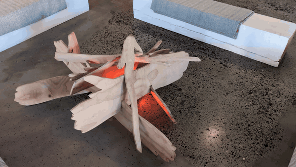
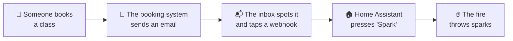
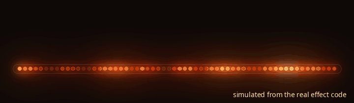

# 🔥 STRETCH Fire

### A cozy LED fireplace that throws sparks every time someone books a class.

*The real thing in the studio. [Full 35 second video (MP4, 8 MB)](assets/stretch-fire-demo.mp4).*

*Built for [STRETCH](https://www.stretchvancouver.com), a yoga studio in Vancouver's Chinatown.*

---

## What is it?

A strip of warm lights that glows and flickers like a real wood fire. It sits quietly in the studio all day. When someone books a class online, the fire **flares up and sends a shower of sparks** up the strip, then settles back down.

No screens, no beeps, no dashboards. Just a little moment of celebration that everyone in the room can feel: *someone new is coming to practise with us.*

| | |
|---|---|
| 🪵 **Looks like a real fire** | Embers glow and fade on their own, with the odd draught dimming the flames, in warm ember-to-amber colours. |
| ✨ **Sparks for every booking** | One booking, one burst. Three bookings in a row? Three bursts, one after another, so you can count them. |
| 🏠 **Part of the smart home** | Turn it on and off, dim it, or change the style from your phone with [Home Assistant](https://www.home-assistant.io). |
| 🔌 **Set and forget** | Plug it in and it lights up. Updates arrive over Wi‑Fi, no cables needed. |

## How does a booking become a spark?

1. **Someone books a class.** STRETCH uses [Momence](https://momence.com), which emails the studio for every new booking.
2. **The inbox spots the email.** A rule in the shared inbox ([Missive](https://missiveapp.com)) watches for emails titled *"New booking for…"* and instantly pings Home Assistant over the internet.
3. **Home Assistant presses the Spark button** on the fire.
4. **The fire flares.** The whole thing takes a second or two.

> [!TIP]
> **Not using Momence or Missive?** Almost any booking system can do this. If it emails you about bookings, or offers webhooks or Zapier, you can point it at Home Assistant. See [the booking trigger guide](docs/booking-trigger.md).

## What's inside

| Part | What it does | Rough cost |
|---|---|---|
| ESP32 dev board | The brains. A tiny Wi‑Fi computer that runs the fire effect. | ~$10 |
| 60 LED strip (WS2812B, 1 m) | The fire itself. Every light can be its own colour. | ~$20 |
| 74AHCT125 chip | A translator so the 3.3 V board can talk clearly to the 5 V lights. | ~$2 |
| 5 V power supply, 2 to 3 A | Powers everything. | ~$15 |
| 330 Ω resistor + 1000 µF capacitor | Protects the lights from spikes. | ~$1 |
| Something to diffuse the light | Frosted tube, paper lantern, a jar, a log-shaped shade... | your call |

**About $50 in parts**, plus an afternoon. Full instructions are in the [build guide](docs/build-guide.md).

## Build your own

1. **Wire it up** following the diagram above ([step by step](docs/build-guide.md#1-wire-it-up)).
2. **Install the software** with [ESPHome](https://esphome.io). It's one command once your Wi‑Fi details are filled in ([how](docs/build-guide.md#2-install-the-firmware)).
3. **Add it to Home Assistant.** It's usually found automatically ([how](docs/build-guide.md#3-add-it-to-home-assistant)).
4. **Connect your bookings** so each one presses the Spark button ([how](docs/booking-trigger.md)).

Something not right? See [troubleshooting](docs/troubleshooting.md).

<b>🛠️ For the technically curious</b>

 

- **Firmware:** [ESPHome](https://esphome.io) on ESP-IDF, using the `esp32_rmt_led_strip` light platform. Config in [`esphome/stretch-fire.yaml`](esphome/stretch-fire.yaml).
- **Effects:** two custom `addressable_lambda` effects in [`esphome/fire_effects.h`](esphome/fire_effects.h):
  - **Hearth**: two octaves of smooth value noise per pixel, a contrast stretch, random "gusts" that dim the whole fire and recover exponentially, and a floor so the coals never go fully dark.
  - **Fire2012**: Mark Kriegsman's classic rising-flame simulation, for strips mounted vertically.
  - Both map "heat" through a warm palette (black, ember, red, orange, amber, pale yellow, never blue or white), and scale each frame to stay under a 2 A power budget.
- **Sparks** are an *overlay*, not an effect, so a booking never resets the fire. Each burst brightens the whole strip toward amber, decaying over about a second, and spawns 8 to 14 near-white sparks that drift along the strip and cool to orange. Bursts queue (up to 20) and play back to back.
- **Home Assistant** gets a light (with Hearth and Fire2012 effects), a **Spark** button, a `spark` action that takes a `count`, plus Wi‑Fi signal, uptime and restart.
- **Trigger:** an HA [webhook automation](home-assistant/automation.yaml) in `queued` mode, so simultaneous bookings each get a burst.
- **Original sketch:** the project started as an Arduino/FastLED sketch with a serial command interface and lots of diagnostics. It's kept in [`arduino/fire_flicker`](arduino/fire_flicker/fire_flicker.ino) for anyone who wants a standalone fire with no smart home.
- **The rendered demo GIF** below is produced by [`tools/render_demo.py`](tools/render_demo.py), a Python port of the same effect maths, so you can see the spark overlay without the hardware.

  

## Credits

- Fire2012 effect by **Mark Kriegsman**, from the [FastLED](https://fastled.io) project.
- Built on [ESPHome](https://esphome.io) and [Home Assistant](https://www.home-assistant.io).
- Made with care at **[STRETCH](https://www.stretchvancouver.com)**, 180 E. Pender St, Vancouver. Come practise with us. 🧡

MIT licensed. Build one for your studio, café, shop or living room.
