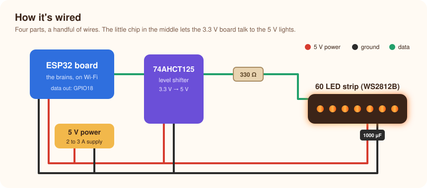

# 🛠️ Build guide

[← Back to the README](../README.md)

This takes an afternoon. You'll need a soldering iron, or a breadboard and jumper wires, and a computer for the one-time software install.

## 1. Wire it up



| From | To |
|---|---|
| 5 V supply **+** | LED strip 5 V, ESP32 **VIN**, 74AHCT125 pin 14 |
| 5 V supply **−** (ground) | LED strip GND, ESP32 **GND**, 74AHCT125 pin 7 |
| ESP32 **GPIO18** | 74AHCT125 pin 2 (input 1A) |
| 74AHCT125 pin 3 (output 1Y) | 330 Ω resistor, then the strip's **DIN** (data in) |
| 74AHCT125 pin 1 (1OE) | GND (switches the first channel on) |
| 74AHCT125 pins 5, 9, 12 | GND (unused inputs) |
| 74AHCT125 pins 4, 10, 13 | 5 V (unused channels off) |
| 1000 µF capacitor | across 5 V and GND where power enters the strip (mind the stripe: that's negative) |

> [!IMPORTANT]
> **All the grounds must be connected together.** This is the most common reason the lights don't work.

> [!TIP]
> - Data goes **into** the end of the strip marked DIN, with the arrows pointing away from it.
> - Want a different pin? Safe choices on an ESP32 are 4, 13, 14, 16 to 19, 21 to 23, 25 to 27, 32 and 33. Avoid 0, 2, 5, 12 and 15, which can stop the board from starting.

## 2. Install the firmware

You'll use [ESPHome](https://esphome.io), free software that turns a simple settings file into firmware for the board.

1. **Install ESPHome** on your computer: `pipx install esphome` (or use the ESPHome add-on inside Home Assistant).
2. **Download this project** and open the `esphome` folder.
3. **Add your Wi‑Fi details:** copy `secrets.yaml.example` to `secrets.yaml` and fill it in. The file explains how to make the random keys.
4. **Adjust for your strip** if needed, in `stretch-fire.yaml`: `num_leds` (how many lights) and `pin`.
5. **Plug the ESP32 into your computer by USB** and run:
   ```bash
   esphome run stretch-fire.yaml
   ```
   Choose the USB port when asked. After this first time, updates go over Wi‑Fi.

> [!WARNING]
> **Use a data USB cable.** Many cables only carry power. If your computer doesn't see the board at all, swap the cable before anything else.

When it starts, the fire comes on by itself at 70% brightness, in the **Hearth** style.

## 3. Add it to Home Assistant

1. In Home Assistant, go to **Settings → Devices & services**. "STRETCH Fire" usually appears as *discovered*. Click **Add**.
2. If it doesn't, click **Add integration → ESPHome** and type the device's address (`stretch-fire.local`, or its IP address).
3. Paste the `fire_api_key` from your `secrets.yaml` when asked.

You'll get:

| In Home Assistant | What it does |
|---|---|
| **Fire** (light) | On/off, brightness, and the effect: **Hearth** (glowing embers) or **Fire2012** (rising flames, for strips mounted upright) |
| **Spark** (button) | One burst of sparks. Press it to try it out! |
| **spark** (action) | Sends several bursts at once, with a `count` |
| **Restart** (button) | Reboots the fire |
| WiFi Signal, Uptime | Health checks |

Next: [connect your bookings](booking-trigger.md).

## Customising the look

The fire's personality lives at the top of [`esphome/fire_effects.h`](../esphome/fire_effects.h):

| Setting | Effect |
|---|---|
| `HEARTH_SPEED` | How fast the embers change |
| `HEARTH_NOISE_SCALE` | Lower = smoother glow between neighbouring lights |
| `GUST_CHANCE`, `GUST_MAX_DIP` | How often and how much a "draught" dims the fire |
| `FIRE_COOLING`, `FIRE_SPARKING` | Flame height and liveliness in Fire2012 |
| `PSU_MAX_MA` | Power limit; set to about 80% of your supply's rating |

After editing, run `esphome run stretch-fire.yaml` again and it updates over Wi‑Fi.
